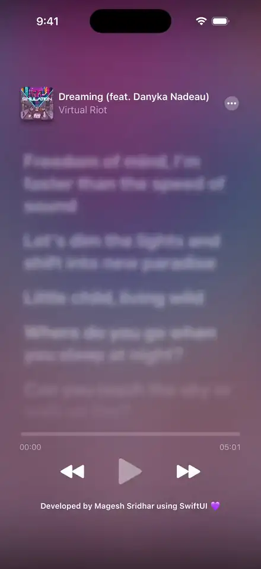

# Progressing Lyrics
A recreation of Apple Music's time-synced lyrics in SwiftUI, with a few extra effects. Lyrics scroll and fill in as the song plays.

  

### It's all in the details:
- The highlight sweeps across the active line as it's sung, and continues onto the next row when a line wraps.
- Each line has its own sweep duration, timed to the song.
- Lines that are not being sung are blurred, and the list scrolls up one line after another instead of all at once.
- Some lines get extra effects: a purple glow that grows as the line is sung, or a horizontal shake.
- The list fades out at the bottom, and the playback bar and times update with the song.

### How it works
Each `Lyric` holds its start time, duration, number of wrapped lines and effect. An `AVAudioPlayer` is polled ten times a second, and a line becomes active when the playback time reaches its start. The highlight is a thick path drawn across every row of the line, trimmed to the current progress and masked by the text.

### Tools and Frameworks used:
- SwiftUI
- `AVAudioPlayer`
- Animatable modifiers
- Masks and trimmed paths

### Requirements
- iOS 18.1 or later
- Xcode 16.1 or later

### Credits
The demo song is "Dreaming (feat. Danyka Nadeau)" by Virtual Riot, written by Christian Valentin Brunn and Danyka Nadeau.
